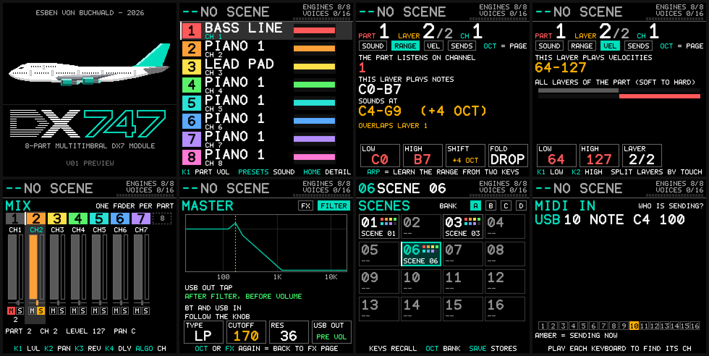

# DX747: an eight-part multitimbral DX7 module for the M-VAVE FM-1

<a href="https://esbenvb.github.io/fm1-dx747/"><b>Try it in your browser and install it on your FM-1 &rarr; esbenvb.github.io/fm1-dx747</b></a> 
<a href="docs/DX747-Manual.pdf"><b>Manual (PDF)</b></a> &middot; <a href="https://github.com/esbenvb/fm1-dx747/releases">Releases</a> &middot; <a href="docs/FLASHING-AND-RECOVERY.md">Flashing and recovery</a>

> **Try it, then install it.** Open **<https://esbenvb.github.io/fm1-dx747/>** in Chrome or Edge on a computer. The page runs the DX747 firmware itself in your browser, with the panel's screen, buttons and keys, so you can play it and build sounds without an FM-1. It is also the **configurator** for a connected unit (parts, layers, scenes, filter) and the **installer**: its Update tab puts DX747 on your FM-1, and the original firmware back. Read [docs/FLASHING-AND-RECOVERY.md](docs/FLASHING-AND-RECOVERY.md) before you install, and the [PDF manual](docs/DX747-Manual.pdf) for everything else.

> **DX747 does for micro synths what the jumbo jet did for air travel half a century ago.**
>
> For the price of a dinner, you get a box in the spirit of the **Yamaha TX816**: eight DX7s in a rack, which cost about as much as a small car in 1984.

**Eight FM engines. Eight parts. Any of sixteen MIDI channels. One compact box that plays your DX7 voices, eight parts at a time.**

DX747 is custom firmware that turns the M-VAVE FM-1 into a **multitimbral, layerable, splittable 6-operator FM sound module**: the glassy electric pianos, the bell-like mallets, the growling basses and the shimmering pads of the DX7 sound world, played and controlled from your keyboard, sequencer, DAW or phone. It replaces the stock sequencer, sampler and drum machine with one job done properly: **a DX7 module that is built for MIDI**.

## The idea

In 1970 the 747 turned long-distance flying from an occasion into something ordinary people could afford. In 1984 the way to get a **multitimbral DX7 sound** was a TX816: eight DX7 tone generators in one rack, one MIDI channel for each, and a price tag to match. DX747 brings that idea to a micro synth that fits in a bag and costs about what a dinner does. It is not a copy: the TX816 has eight separate audio outputs, DX747 mixes its eight parts to one output and adds layering, keysplits, scenes and USB audio on top.

## Why you will love it

- **8-part multitimbral.** Eight independent parts, each on its own MIDI channel (pick any of the sixteen). Give up to eight tracks of your sequencer, controllers on your stage or channels of your DAW their own sound, all at once, with sixteen voices shared between them.
- **Layering with no extra modes.** Stack up to **eight DX7 voices in a single part**: a bright e-piano on top of a warm pad, a bell over a bass, a thick stack of leads. Every layer has its own level, pan, reverb send, delay send, BRIGHT and voice limit, so you balance the stack like a mix.
- **Keysplits you can set by playing.** Give each layer its own **note window** and the keyboard splits into bass, comp and lead, or into as many zones as you have layers. Press ARP (LEARN) on the Part or Range screen, play the lowest and the highest key, and the window is set.
- **Velocity switching.** A **velocity window** per layer lets a soft touch play one sound and a hard hit another: velocity-layered pianos, soft and hard brass, a pad that blooms when you dig in. No sequencer tricks needed. (Play it from a velocity-sensitive MIDI keyboard; the built-in keys send a fixed velocity.)
- **Octave shift and fold, per layer.** Move any layer by up to **four octaves up or down**, and choose what happens to notes the shift pushes outside the MIDI range: drop them, clip them to the nearest end, or wrap them back by whole octaves. A keysplit with an octave change is one window and one shift: bass an octave down on the left, lead an octave up on the right.
- **Engines are your budget.** Eight single-layer parts, one monster part of eight layers, or anything in between. A note on a part takes one of the sixteen shared voices for each of its layers, and the screen header shows how many engines and voices you are using.
- **A mixer made for parts.** One fader per part, level meters, **mute and solo for the whole stack**, and pan and both effect sends for the whole part, with the spread between its layers kept. Fine-tune each layer on the edit pages. MIDI CC7 moves the part fader, so your DAW's automation mixes the module too.
- **BRIGHT: an FM "filter" in one control.** One macro (or CC74 / CC71 from your controller) opens and closes the sound by moving the modulators and leaving the volume alone, on a single layer or on a whole part.
- **Master filter, shared reverb and delay.** A low-pass, high-pass or band-pass filter with resonance over the whole mix of the engines, answering to MIDI on a channel of your choice, plus a shared reverb and delay with a send on every layer.
- **Scenes: your whole rig in one press.** Store **64 scenes** in four banks of 16, each with all eight parts, their layers, splits, shifts, levels, sends, the filter and a name. Recall them from the white keys, step through a setlist with the buttons, or switch with a **program change on a scene channel you choose**. Your last scene is waiting when you switch on, and a power cut in the middle of a save can never damage another scene.

## Made to be controlled

- **MIDI in from everywhere.** DIN, USB and Bluetooth LE MIDI all feed one router, together with the built-in keyboard. Merge several controllers on different channels.
- **DX7 SysEx editing.** A DX7 editor can change voice parameters in real time, one layer at a time, and send single voices straight to a layer.
- **Program change** picks any of the 128 voices on a part's channel, and **CC7, CC10, CC11, CC64, CC91 and pitch bend** do what you expect.
- **128 factory voices** in four banks of 32, plus **DX7 ROM cartridge import** from the M-VAVE workbench.
- **USB audio out** of the finished mix, taken after the master filter, so the computer records what you designed. Bluetooth audio in lets a phone or computer play along.
- **A live MIDI monitor** lists the latest notes, controllers and program changes with the port (DIN, USB, Bluetooth or the keys) and the channel they came in on, and lights every channel that is sending, so finding the right channel is a glance.

## Play it, too

The built-in 27-key keyboard plays the part you have selected on every screen, through the same router as everything else: layers, splits and shifts included (on the Scenes screen the white keys recall scenes instead). Shift it two octaves either way, and see every part, its layers and its key ranges on the 240x240 colour screen.

## Perfect for

- a **live keyboard rig** with a scene per song
- a **hardware sequencer or DAW setup** with one DX7 sound per track
- **layered pads and stacked pianos** from a single key press
- a **bass-and-lead split** on one controller
- a **compact studio sound module** with USB audio and MIDI

> **Status.** DX747 has been flashed to a real FM-1 and tested by its author, and it works great. It is still a young hobby project, so read [DX747.md](DX747.md) and [docs/ON-DEVICE-CHECKLIST.md](docs/ON-DEVICE-CHECKLIST.md) before you trust it with a gig, and [docs/FLASHING-AND-RECOVERY.md](docs/FLASHING-AND-RECOVERY.md) before you flash it.
>
> **Switching firmware.** DX747 has its own identity, `FM-1_8747747`, and brings M-VAVE's update loader, so another firmware can be installed over it and the official V15 can be put back. It has no sequencer, sampler or projects, so **it cannot read the projects or samples of another firmware**, and DX747 ignores the ones on the unit. Back up what you want to keep before you install, and see [docs/FIRMWARE-HUB.md](docs/FIRMWARE-HUB.md) for how it is listed on The Firmware Hub.

---

> **This tree is DX747**, custom firmware that makes the FM-1 an eight-part multitimbral DX7 module controlled over MIDI. It replaces the stock sequencer, sampler and screens. Start with [DX747.md](DX747.md); build instructions are in [docs/BUILDING.md](docs/BUILDING.md); read [docs/FLASHING-AND-RECOVERY.md](docs/FLASHING-AND-RECOVERY.md) before flashing. The text below is the SDK's own README for the stock firmware it is based on.
>
> **DX747 is a tribute to the Yamaha DX7.** It is an independent hobby project and is **not in any way associated with, endorsed by or sponsored by Yamaha Corporation or The Boeing Company** (or by M-VAVE). "DX7" is a Yamaha product name and "747" is a Boeing aircraft designation; any trademarks of Yamaha or Boeing, including "DX7" and "747", belong to their owners, and the names are used here only to say what the firmware is a tribute to and what its logo looks like. No rights to them are claimed. The firmware has its own identity (release V01, update identity `FM-1_8747747`) and replaces M-VAVE's Open V14 rather than being a version of it. See [DX747.md](DX747.md), "Licence and names".

## Build

DX747 builds on macOS and Linux with Docker and Node 18 or newer, and on Windows with JieLi's Windows toolchain 2.5.3 (`build.bat`,
`build.bat --web` and `build.bat --package`; the Windows steps, the toolchain installation and the troubleshooting are in
[docs/BUILDING.md](docs/BUILDING.md), Option A). **Get the source by cloning the repository** into any folder, and run every
command from its root; nothing depends on where it is:

~~~
git -c core.autocrlf=false clone --branch dx747 https://github.com/esbenvb/fm1-dx747.git
cd fm1-dx747
~~~

(`-c core.autocrlf=false` keeps Git from changing line endings: the build checks the SDK files byte for byte.) Then:

~~~bash
./build.sh --setup            # once: JieLi's Linux toolchain (26 MB) and WASI SDK 27, both hash-checked
./build.sh                    # firmware: build, the SDK's checks, package
./build.sh --web              # browser preview
./build.sh --package --source-url "https://github.com/<you>/fm1-dx747/archive/$(git rev-parse HEAD).zip"
~~~

It uses the same compiler release (clang 4.0.1) and the same flags and checks as the Windows build, in a container, and takes about 20
seconds. The [build guide](docs/BUILDING.md) has the details, the troubleshooting tables and
[how the two routes were compared](docs/BUILDING.md#how-the-two-routes-compare).

DX747 is a fork of M-VAVE's open firmware (`FM1_OFFICIAL_OPEN`) and has its own file names. The SDK scripts write the upstream names,
`build/dx7/generated/FM1_OFFICIAL_OPEN.fwsc` and `build/official-web/FM1-Official-Open-Source.html`; the build leaves a copy of
each under DX747's names, **`FM1_DX747.fwsc`** and **`FM1-DX747.html`**, and `./build.sh --package` also builds
**`DX747-Workbench.html`** (the configurator, simulator and updater, [DX747.md](DX747.md)) in the same folder.

### SMK-37 Pro and Elite (experimental, never run on a unit)

The same firmware has a second target for M-VAVE's SMK-37 (`targets/smk37/`): the 37 keys play with velocity, the 16 pads recall scenes
and mute and solo, the four faders are part volumes (FADER BANK for parts 5 to 8), the wheels and the pedal play the selected part.
It is built with **M-VAVE's own SMK-37 SDK** (`m-vave/smk37_open`, copied unchanged; the FM-1 SDK is never linked into it):

~~~bash
./build.sh --target smk37-pro      # build/smk37-pro/dx7/generated/SMK37_DX747_PRO.fwsc, update identity SMK-37 Pro_8747747
./build.sh --target smk37-elite    # build/smk37-elite/dx7/generated/SMK37_DX747_ELITE.fwsc, update identity SMK-37 Elite_8747747
~~~

It passes the build's size, symbol and identity checks and its controls run in the simulator tests, but **this project has no SMK-37**:
nothing has been tried on a unit, so do not install it on one before [docs/ON-DEVICE-CHECKLIST-SMK37.md](docs/ON-DEVICE-CHECKLIST-SMK37.md)
has been worked through. The Firmware Hub does not install SMK-37 firmwares, and this one is not offered there. [targets/smk37/README.md](targets/smk37/README.md)
says what each folder is.

### Distribution builds

For a build you distribute, `FM1_SOURCE_URL` (or `--source-url`) must be the HTTPS URL of the matching source archive, including your
changes, licenses and build/install scripts. A moving GitHub `tree/main` page is not a matching source archive.

The [per-track tuning API](app/instrument.h) supports custom tuning; a dedicated tuning editor is not included.

## License

APP: [GPLv3 with the FM1 SDK linking exception](LICENSE.md). The device engine is supplied as a binary SDK with separate terms. Retain the applicable [SDK terms, third-party licenses and contributor notices](THIRD_PARTY.md) when distributing builds.
