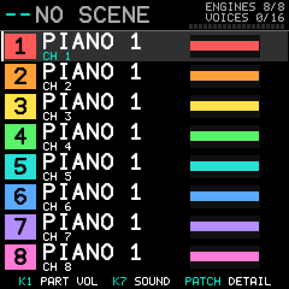{.cover}

::: {.cover-text}
**Eight FM engines. Eight parts. Any of sixteen MIDI channels.**
Your DX7 voices, eight at a time, on the SMK-37's keys, pads, knobs and faders.

**Experimental: this firmware has never run on an SMK-37.** Everything in this manual was tried in a simulator.

Source, releases and documents: <https://github.com/esbenvb/fm1-dx747>
:::

::: {.contents}
## Contents

1. [What DX747 is](#what-dx747-is)
2. [Installing, and going back](#installing-and-going-back)
3. [The panel](#the-panel)
4. [The screens](#the-screens)
5. [Building a sound](#building-a-sound)
6. [MIDI](#midi)
7. [The workbench page](#the-workbench-page)
8. [Limits, and what is not in this version](#limits-and-what-is-not-in-this-version)
9. [Troubleshooting](#troubleshooting)
10. [Credits and licence](#credits-and-licence)
:::

# 1 What DX747 is

DX747 is custom firmware that turns the SMK-37 into a **multitimbral, layerable, splittable six-operator FM sound module**: the electric pianos, bells, basses and pads of the DX7 sound world, played from the SMK-37's keys or from any MIDI source, and shaped with its knobs, faders and pads.

::: {.notice}
**Read this first.** This project has no SMK-37. The firmware builds, passes its size, symbol and identity checks, and its screens and controls were run in a simulator that is fed the events the unit's scanner is expected to send. **Nothing has been tried on a unit.** Two things in this manual are therefore assumptions until someone checks them on hardware: that each printed button is the button this manual says it is (the names were matched to the board's button numbers by position, from the drawing in M-VAVE's manual), and how the faders, pads and flash behave. The list is `docs/ON-DEVICE-CHECKLIST-SMK37.md` in the repository. Do not install this firmware before you have read section 2.
:::

It is not a sequencer, a drum machine or a sampler. It has no projects and no samples. The SMK-37's own sequencer, arpeggiator, note repeat, scale and chord functions are not in DX747, and their buttons have other jobs here (section 3).

DX747 is a fork of M-VAVE's open firmware for the SMK-37 (SMK37 Open) and has its own identity: release label **V01**, update identity **SMK-37 Pro_8747747** for the Pro and **SMK-37 Elite_8747747** for the Elite. The Pro and the Elite run the same code; only the update identity and the model check in the updater differ, so there is one package for each model and this one manual. DX747 is an independent hobby project by Esben von Buchwald, licensed GPL-3.0 with the SDK's linking exception. It is a tribute to the Yamaha DX7 (section 10).

## The idea in four lines

- A **part** is one MIDI channel with one sound. There are up to **eight** parts, each on its own channel (1 to 16).
- A part's sound is **one to eight layers**. A layer is one DX7 voice on one engine, with its own note window, velocity window, octave shift, level, pan, effect sends and voice limit.
- **Engines are the only limit.** There are eight engines. Eight single-layer parts, or one part of eight layers, or anything in between. The header of every screen shows the **scene** (number and name, or `--` and `NO SCENE`) at the left, and at the right `ENGINES n/8` and `VOICES n/16`.
- Sixteen voices are shared between all engines. A note on a part with n layers uses n voices. When they run out, the oldest note is taken.

A fresh unit starts with eight single-layer parts on channels 1 to 8, so a sequencer can use all eight at once. **To layer, free an engine first**: select a part and press **CHORD** to remove it, then select another part and press **SCALE** to give it a second layer (section 5).

**How this manual names things.** Every control is called by the label printed on the SMK-37: the buttons **KNOB BANK**, **FADER BANK**, **<**, **>**, **OCTAVE-**, **OCTAVE+** under the screen and **ARP**, **NOTE REPEAT**, **SCALE**, **CHORD**, **GLOBE**, **BT**, **PATCH**, **PARA**, **FX**, **SEQ**, **SEQ PLAY**, **SEQ REC** below the faders; the knobs **K1** to **K8**; the faders **FADER1** to **FADER4**; the **pads**; the **keys**; **PITCH** and **MOD**. DX747 on the SMK-37 uses no SHIFT: every function has a button of its own.

# 2 Installing, and going back

**Read this before you flash.** A firmware that does not start can leave a unit that the web updater cannot repair, and **this one has never been started on an SMK-37**. The steps below are what the project has prepared; none of them has been carried out on a unit.

1. **Have a way back first.** Install M-VAVE's own SMK37 Open V01 first, to learn the update path and to check that the unit's restore works (the Pro and Elite V16 packages are in `targets/smk37/sdk/firmware/` of the repository). A hardware programmer that can read and rewrite the unit's flash, and a backup of the flash made with it, is the only protection against a unit that does not start.
2. **Back up your own data.** DX747 has no sampler and cannot read M-VAVE's projects or samples. The first time you save a scene, DX747 asks to erase the flash area that holds stock data, because scenes live there (below). Save what you want to keep **before** you install, while the original firmware is on the unit.
3. **Build the package.** There is no download for the SMK-37 yet and the Firmware Hub does not install SMK-37 firmwares. On a Mac or Linux computer with Docker, `./build.sh --target smk37-pro` or `./build.sh --target smk37-elite` writes `SMK37_DX747_PRO.fwsc` or `SMK37_DX747_ELITE.fwsc` (`docs/BUILDING.md`, "DX747 for the SMK-37"). The Pro and Elite packages differ in their update identity; use the one for your model.
4. **Install with M-VAVE's installer or the SMK-37 workbench**, with Chrome or Edge on a computer, the unit connected by USB, the computer set not to sleep and no other MIDI program using MIDI. **While it writes, keep USB and power connected, keep the computer awake and the tab open, and touch nothing.** The unit should restart into DX747: the Parts screen.
5. **Going back.** Install the unit's V16 package (step 1) with the same installer.

**Switching on.** The screen shows the DX747 logo, then the Parts screen. Any button, key, pad or knob ends the logo.

**Safe boot.** Hold **SCALE** and **CHORD** while switching on. DX747 then starts nothing of its own: no engines, no scenes, no flash, no radio setup. The screen says SAFE BOOT, and the firmware updater still works.

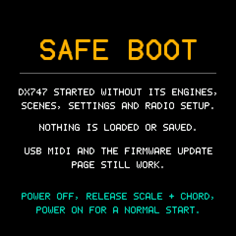{.shot}

Switch off, let go and switch on again for a normal start. **Safe boot has been tested in the simulator and not on a unit, and it cannot help if the unit fails before the chord is read: it is not a replacement for a hardware programmer.**

**The first scene you save.** Scenes need flash that holds stock data on an SMK-37 that has not saved one. The screen then says FIRST SAVE: FLASH SETUP and **SEQ REC = ERASE AND CONTINUE**: pressing **SEQ REC** there erases that area and cannot be undone. Press **PATCH** to cancel; until you agree, DX747 writes nothing to that flash, not even the System settings, which therefore do not survive a power cycle yet.

# 3 The panel

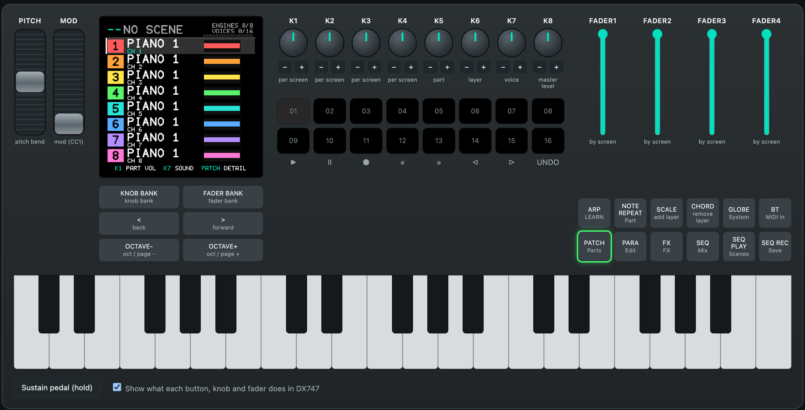{.wide}

## The buttons

| Button | What it does |
|----|------------|
| **KNOB BANK** | On Mix, K1 to K4 pan parts 1 to 4, or parts 5 to 8. The lamp is lit for parts 5 to 8. |
| **FADER BANK** | Where the faders are part levels, FADER1 to FADER4 are parts 1 to 4, or parts 5 to 8. The lamp is lit for parts 5 to 8. |
| **<** and **>** | One step back and forward: the part on Parts, Mix and FX; the layer on Part, Details and the edit pages; the next or previous stored scene on Scenes (it is recalled); the value of the row on System; the cursor while a scene is named. |
| **OCTAVE-** and **OCTAVE+** | The keys one octave down or up (up to two octaves) on Parts, Part, Mix and MIDI in. The previous or next page on the edit pages, FX and the Master filter; the previous or next part on Details; 16 scenes (a bank) on Scenes; the previous or next row on System. |
| **ARP** | LEARN: play the lowest and the highest key to set the note window of a layer (Part and Range screens). |
| **NOTE REPEAT** | The Part screen: the layers of the selected part. |
| **SCALE** | Add a layer to the selected part; in an empty slot, make a new part. On Parts, Part, Details, the edit pages and Mix. |
| **CHORD** | Remove the framed layer; the last layer takes the part with it. On the same screens. The left button adds and the right one removes. |
| **GLOBE** | The System screen. |
| **BT** | The MIDI in screen. |
| **PATCH** | The Parts screen. Press again: the selected part in detail. Cancels the naming of a scene. |
| **PARA** | The edit pages of the framed layer: Sound, Range, Velocity, Sends. One page on at each press. |
| **FX** | The shared reverb and delay. Press again: the Master filter. |
| **SEQ** | The Mix screen. |
| **SEQ PLAY** | The Scenes screen. |
| **SEQ REC** | Save the setup as a scene (section 4, Scenes). |
| hold **SEQ PLAY**, then **OCTAVE-** or **OCTAVE+** | Recall the previous or next stored scene, from any screen. |
| hold **PATCH**, then **SEQ PLAY** | Stop every note. |

The lamp of the button that opens the screen on view is lit. **KNOB BANK** and **FADER BANK** are lit while they select parts 5 to 8.

## The knobs

| Knob | What it does |
|----|------------|
| **K1** to **K4** | What the screen names in its bottom line or its row of four tiles: levels, range, effect amounts and so on. On Mix, K1 to K4 are the pan of parts 1 to 4, or 5 to 8 after **KNOB BANK**. |
| **K5** | Picks the part. On Scenes it moves the scene cursor, on System the row. |
| **K6** | Picks the layer inside the part (the framed layer). On Mix it sets the MIDI channel of the part. |
| **K7** | Chooses the voice (1 to 128) of the framed layer. On System it changes the value of the row. |
| **K8** | The master level of everything you hear. |

Every knob turn and every message ("LAYER ADDED", "NO FREE ENGINE") shows a box for a moment: what it is in small letters and the new value large, with a bar where the value has a range. Turning **K7** shows the list of seven voices around the current one.

## The faders

What a fader controls depends on the screen. A fader **sets its thing as soon as it moves**, wherever it was left: there is no pickup, so the level, the filter or the effect jumps to where you put the fader. At power-on the faders' positions are only read; nothing is taken from them.

| Fader | Parts | Master filter | Details and FX | Everywhere else |
|----|----|----|----|----|
| **FADER1** | filter cutoff | filter type | reverb decay | level of part 1 (part 5 after **FADER BANK**) |
| **FADER2** | filter resonance | filter cutoff | delay time | level of part 2 (6) |
| **FADER3** | filter type | filter resonance | delay feedback | level of part 3 (7) |
| **FADER4** | not used | not used | effects return | level of part 4 (8) |

Moving the cutoff or the resonance on Parts turns an off filter into a low-pass filter. A fader on a part that does not exist does nothing.

## The pads

The 16 pads are two rows of eight. Their colours show what they do:

| Screen | Top row (pads 1 to 8) | Lower row (pads 9 to 16) |
|----|----|----|
| **Mix** | **Mute** parts 1 to 8: dim red, bright red while muted, dark where there is no part. | **Solo** parts 1 to 8: dim amber, bright amber while soloed, dark where there is no part. |
| **Part**, **Details** and the **edit pages** | Pick **layer** 1 to 8 of the selected part, in the part's colour: bright for the framed layer, dim for the others, dark where there is none. | Pick **part** 1 to 8, in each part's colour: bright for the selected part. |
| **Everywhere else** (Parts, FX, Master filter, Scenes, System, MIDI in) | **Recall scene** 1 to 16 of the bank on screen. Dark: empty. Teal: stored. Bright teal: the scene in use. White: the cursor. | **Recall scene** 9 to 16 of the bank on screen. |

A pad on an empty scene slot says which button stores a scene: EMPTY SLOT, SEQ REC STORES HERE. The symbols printed under the lower row of pads are not used.

## The keys, wheels and pedal

The 37 keys play the **selected part** on every screen, with the velocity they are struck with, through the same router as MIDI: layers, splits and shifts included. **OCTAVE-** and **OCTAVE+** move them by up to two octaves where the screen has no pages. **PITCH** bends by two semitones, **MOD** is the mod wheel (vibrato), and the sustain pedal holds the notes. A key that started a note always ends it, whatever has happened since.

**Colours.** The accent, used for titles, tabs and frames, is the green of the DX7's buttons. Control names in the tips at the bottom of the screens are green, and the function is white. Parts have fixed colours: red, orange, yellow, green, teal, blue, violet and pink for parts 1 to 8.

**Note names** use the convention where MIDI note 60 is C4.

# 4 The screens

## Parts

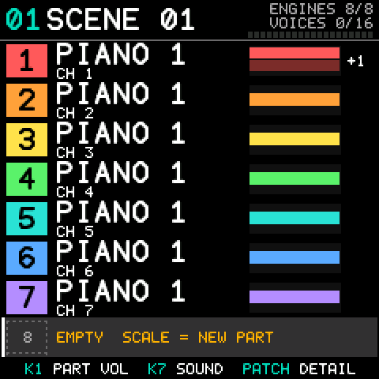{.shot}

Eight rows, always in the same layout: the part number in a coloured chip, the **name** (the name given in the workbench page, or the voice of the part's main layer), the MIDI channel as `CH n` under it, and a small bar of the layers over the keyboard (splits side by side, layers stacked). `+n` counts the other layers. An amber dot says the part is sounding. The selected part is framed.

**K5** or **<** and **>** pick a part, **SCALE** adds a layer to it (or makes a part in an empty slot, as the row says), **CHORD** removes the framed layer (the last layer takes the part with it). **K1** sets the part's volume, **K7** changes the voice of the framed layer. The faders are the master filter (section 3); the pads recall scenes.

## Part in detail (PATCH twice)

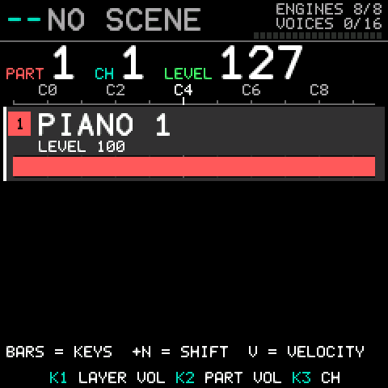{.shot}

One line per layer over a keyboard ruler: the sound, its keys as a bar, an octave shift as a small amber tag, its level, its pan if off centre, and its velocity window if narrowed. The big numbers are the part, its **channel** (**K3**) and its **level** (**K2**). **K1** sets the framed layer's own level, **K6** or **<** and **>** frame a layer, **ARP** learns its keys, **OCTAVE-** and **OCTAVE+** step to the previous and next part. The pads pick layers (top row) and parts (lower row); the faders are the shared effects.

## Part (NOTE REPEAT)

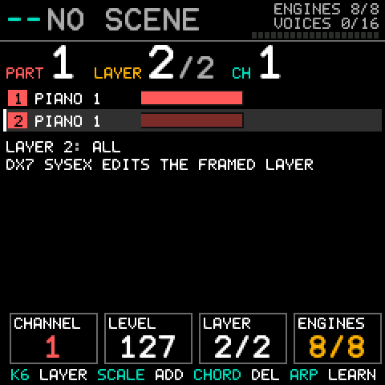{.shot}

The layers of the selected part with their windows, shifts and velocity windows. **K6** or **<** and **>** frame a layer; the framed layer is the one that takes DX7 SysEx. **K1** moves the part to the next free MIDI channel, **K2** sets the part level. The pads pick layers and parts; the faders are the part levels.

## The layer pages (PARA)

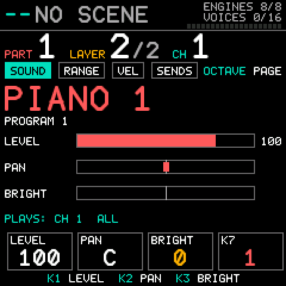{.shot}

Four pages for the framed layer; **PARA** or **OCTAVE-** and **OCTAVE+** step between them, and **<** and **>** frame another layer. Every page has the same header: the part, the layer and the channel as large numbers with small coloured captions.

| Page | K1 | K2 | K3 | K4 |
|----|----|----|----|----|
| **Sound** | layer level | pan | BRIGHT | |
| **Range** | lowest note | highest note | octave shift | fold |
| **Velocity** | lowest velocity | highest velocity | | |
| **Sends** | reverb send | delay send | max voices | |

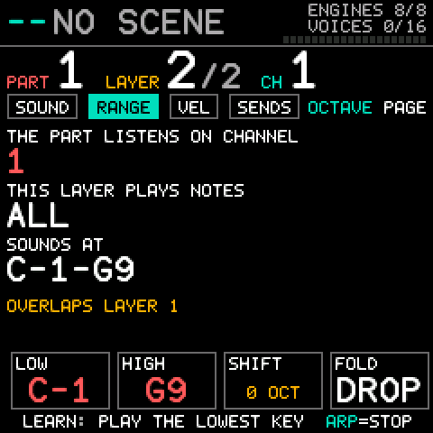{.shot}

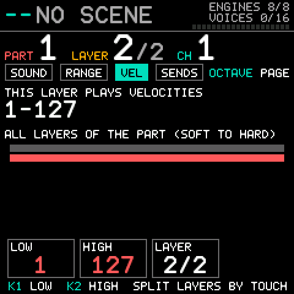{.shot}

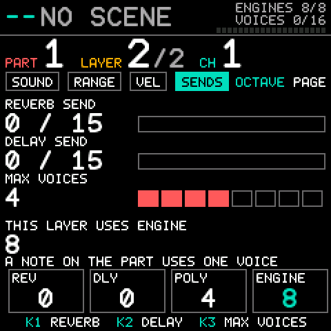{.shot}

**Fold** says what happens to a note the octave shift pushes outside the MIDI range: **drop** it, **clip** it to the nearest end, or **wrap** it back by whole octaves.

## Mix (SEQ)

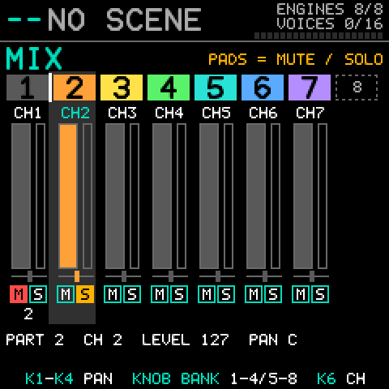{.shot}

One column per part with its channel under the number. Every control works on the **whole part**: the **faders** are the levels of four parts (MIDI CC7; **FADER BANK** switches between parts 1 to 4 and 5 to 8), **K1** to **K4** are their pan (**KNOB BANK** switches between parts 1 to 4 and 5 to 8), the **top row of pads** mutes a part and the **lower row** solos it. **K5** or **<** and **>** select a part, **K6** moves it to the next free channel. A muted part has a filled red M, a soloed one an amber S, and parts silenced by someone else's solo are dimmed. Solo is not saved in scenes. Pressing a part's pad also selects the part.

On Mix the keys still play, **OCTAVE-** and **OCTAVE+** still move them, **SCALE** and **CHORD** still add and remove a layer, and **PARA** opens the edit pages. Reverb and delay sends per part are not on the knobs here: they stay per layer on the Sends page.

## FX and the Master filter

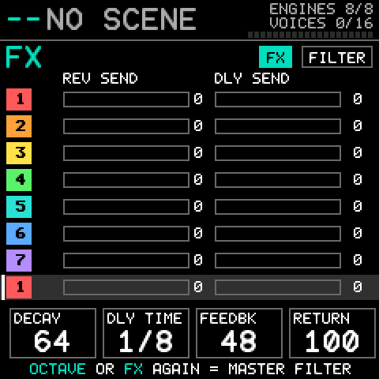{.shot}

**FX** shows each layer's reverb and delay send as bars (**K5** or **<** and **>** pick the part) and, in the four tiles, the shared effect: decay, delay time, feedback and return (**K1** to **K4**, or **FADER1** to **FADER4**). A layer's own amounts are set on the Sends page. Press **FX** again, or **OCTAVE-** or **OCTAVE+**, for the **Master filter**: type (off, low pass, high pass, band pass), cutoff and resonance, drawn as a curve (**K1** to **K3**, or **FADER1** to **FADER3**).

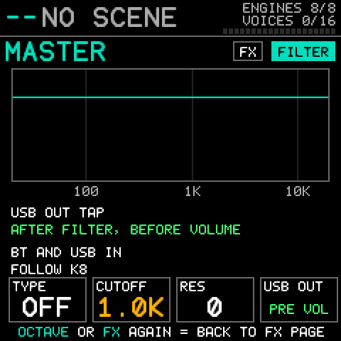{.shot}

The filter sits on the mix of the eight engines. Audio that arrives over Bluetooth (System: Bluetooth audio in) is added after it, so the filter does not touch it.

## Scenes (SEQ PLAY)

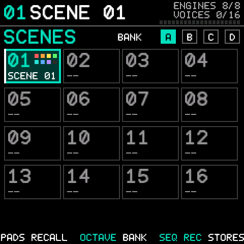{.shot}

64 scenes in four banks (A to D) of 16. **Pad n recalls scene n** of the bank on screen. **OCTAVE-** and **OCTAVE+** change the bank, **<** and **>** step to the previous and next stored scene and recall it. **K5** moves the **scene cursor**, which starts on slot 1 each time you switch on; a pad on a stored scene recalls it, which replaces the current setup before you save.

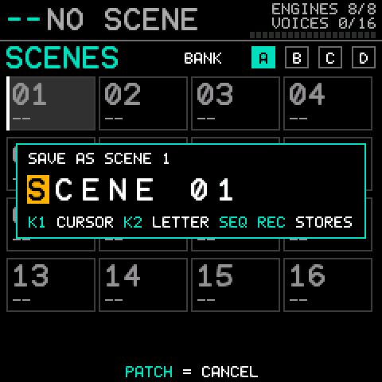{.shot}

**SEQ REC** stores the current setup. From any screen it jumps to Scenes and opens the name editor with the slot's existing name; edit the name with **K1** (cursor) and **K2** (letter), or move the cursor with **<** and **>**, then press **SEQ REC** again to store. **That overwrites a scene that is already in the slot, without asking**; **PATCH** cancels.

A scene stores all eight parts (channel, level, layers, each with voice, windows, shift, fold, voice limit, level, pan, sends, BRIGHT and mute), the selected part, the effects, the master filter and a 12-character name. It stores a **copy** of the voices, so editing a patch later never changes an old scene. The last scene used comes back at power-on. A power cut while saving can never damage another scene. The first save on a fresh unit asks to erase flash first (section 2).

## System (GLOBE)

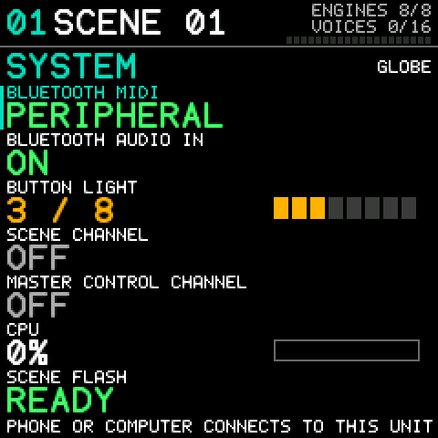{.shot}

**K5** or **OCTAVE-** and **OCTAVE+** pick a row, **K7** or **<** and **>** change it. The rows: Bluetooth MIDI (PERIPHERAL: a phone or computer connects to the unit; read-only), Bluetooth audio in (on or off), button light (0 to 8), the **scene channel** and the **master control channel** (each Off or 1 to 16, section 6), CPU load (read-only) and **scene flash**: `NEEDS SETUP` on a unit that has not saved a scene yet, `READY` afterwards. These are device settings and are not part of a scene.

## MIDI in (BT)

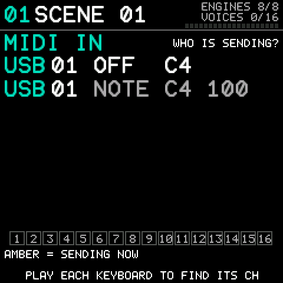{.shot}

A live list of the latest notes, controllers and program changes with the port (USB, Bluetooth or the keys) and the channel they came on. Every channel that is sending lights up, so finding the right channel is a glance.

# 5 Building a sound

## Voices

The 128 voices are four banks of 32: A is 1 to 32, B 33 to 64, C 65 to 96, D 97 to 128. Turn **K7** on the Parts, Part or detail screen or on a layer page. The list shows three voices before and three after the current one.

## Layering

On a fresh unit all eight engines are in use, so first select a part you do not need and press **CHORD** on it. Then select the part you want to layer and press **SCALE**: it gets a second layer on the lowest free engine, with the full keyboard, full velocity range and level 127, which is a **stack**; narrow the note window to make a split. The new layer is the framed one, so **K7** gives it a voice at once. To work on another layer use **K6** or **<** and **>**, and give each layer its own voice, level, pan and sends so that you balance the stack like a mix. Up to eight layers fit in one part if the engines are free.

On the Part screen the pads do the same quickly: a pad in the lower row picks a part, a pad in the top row picks one of its layers.

## Splits: set a note window by playing it

On the Part or Range screen press **ARP** (LEARN), then play the **lowest and the highest note**, in either order, on the keys or any MIDI keyboard. The window of the framed layer becomes those two notes. Two layers with windows that do not overlap make a keysplit; layers with the same window make a stack.

## Velocity switching

On the Velocity page give each layer a window of velocities. A soft touch can play one sound and a hard hit another. A layer plays a note only when its velocity is inside the window (1 to 127, the default, accepts everything). The SMK-37's keys send the velocity they are struck with; how evenly they do that is on the on-device checklist.

## Octave shift

Each layer moves up to **four octaves** up or down (Range page, **K3**). A split with an octave change is one window and one shift: bass an octave down on the left, lead an octave up on the right. A shift shows as a small amber tag on the detail screen.

## BRIGHT

BRIGHT is an FM "filter" in one control. It moves the output level of the **modulator** operators of the voice, never the carriers, so the sound gets brighter or duller without getting louder or quieter. It is on the Sound page (**K3**), and MIDI CC74 or CC71 on a part's channel sets it for all the part's layers. The voice's own levels are remembered: changing the voice starts again from the new voice.

## Voice limit

Each layer has its own limit, 1 to 8 voices (default 4), on the Sends page. A note uses one voice per layer that plays it.

# 6 MIDI

**Connecting.** DX747 takes MIDI on USB (the SMK-37 shows up on the computer as a USB MIDI device) and over Bluetooth LE: the phone or computer connects to the SMK-37, which is a Bluetooth peripheral (System screen: Bluetooth MIDI, PERIPHERAL). The SMK-37 has no MIDI input on its TRS socket. Both ports feed one router, together with the keys.

**DX747 only receives.** It sends no MIDI: the keys, pads, knobs and faders play and control the unit's own engines and are not sent out. MIDI clock and transport (start/stop) messages are not used, and SysEx other than the DX7 messages below and the workbench's own is ignored. System Reset acts as a panic (all sound off).

A note on channel c is played by every layer of the part on c whose note window and velocity window contain it, moved by that layer's shift. A note off always reaches the engines that got the note on, even if settings changed meanwhile.

| Message | Effect |
|----|------------|
| Note on/off | Plays the voice at the velocity it arrived with. |
| Program change 0 to 127 | Picks the part's sound. On a one-layer part it loads that voice. On a **layered** part it replaces all layers with that one voice over the whole keyboard (the first layer stays at its own level). |
| Bank select (CC0) | Remembered per channel. Only bank 0, the DX7 voices, exists; a program change after another bank is ignored. |
| CC7 | The **part level**. Every layer plays at its own level times the part level / 127. |
| CC10, CC11 | Pan and expression. |
| CC74 or CC71 | The **BRIGHT** of every layer of the part (64 is centre, 127 is +50, 0 is −50). |
| CC91 | Reverb send. |
| CC1, channel pressure | Vibrato. |
| CC64 | Sustain pedal. |
| Pitch bend | Plus or minus two semitones. |
| CC120, CC121, CC123 | All sound off, reset controllers, all notes off. |

**Scene channel.** Set one on the System screen (Off by default; remembered). A program change on that channel recalls scene n + 1 (0 to 63); an empty slot does nothing. Use a channel no part uses, because a program change there never reaches a part.

**Master control channel.** Set one on the System screen, on a channel **no part uses**: the controllers below are taken for the filter and never reach a part, so a part on that channel would lose its CC74 and CC71 BRIGHT, and the unit does not warn you about this one. On it, **CC74** is the filter cutoff (20 Hz to 20 kHz), **CC71** the resonance, and **CC70** the type (0 to 31 off, 32 to 63 low pass, 64 to 95 high pass, 96 to 127 band pass).

## DX7 SysEx and editors

A DX7 editor can change voice parameters in real time and send single voices (163 bytes). They go to the **framed layer** of the part on the message's MIDI channel (a DX7 message carries a device number *n* from 0 to 15, which is MIDI channel *n* + 1, so set your editor's channel to the part's channel; frame a layer with **K6** on the Part screen, layer 1 until you do). A layered part is therefore never overwritten by accident. The 32-voice bank dump (4,104 bytes) cannot reach the unit over MIDI, because the input discards SysEx over 1,024 bytes: load banks with the workbench page (next section). The unit does not send voice dumps.

The complete reference, including the SysEx formats, is <https://github.com/esbenvb/fm1-dx747/blob/dx747/docs/MIDI.md>.

# 7 The workbench page

The same workbench page serves both units: <https://esbenvb.github.io/fm1-dx747/> opens for the FM-1, and the **Device** menu at the top right switches to the **SMK-37** page. A local build is `./build.sh --web --target smk37-pro`. Open it in **Chrome or Edge on a computer**.

At the top choose **Simulator** (the DX747 firmware compiled to run in the page, with the SMK-37's panel: the screen, 18 buttons, 8 knobs, 4 faders, 2 wheels, a pedal, 16 pads and 37 keys; its sound comes from an open stand-in for the sealed sound engine, rendered in the browser with more latency than the unit's, so it is a test bench and not a substitute for the unit) or **Connect SMK-37 (USB)** (your unit, over Web MIDI with SysEx allowed). Every tab then works on the chosen target, and the page follows the unit: a change made on the panel shows in the page and the other way round.

| Tab | What it is |
|----|------------|
| **Device** | The simulator panel, with what DX747 does under every button, knob and fader (the box at the bottom turns it off) and the whole story in the tooltip of each control. Click once to switch the sound on. Its scenes and settings are kept in the browser. |
| **Configure** | All eight parts and their layers: channel, level and name per part; per layer the voice, level, pan, BRIGHT, reverb and delay, key range on a keyboard, octave shift, fold, velocity window, polyphony, mute and solo. Add and remove layers and parts. **Play this part** selects the part the keys play. |
| **Sounds** | The 128 voices in four banks by name (click one to give it to the framed layer) and **DX7 ROM import** into a bank. |
| **Scenes** | The 64 scenes: names, which parts they hold, recall, save, rename, delete. |
| **Master and FX** | The master filter, the shared reverb and delay, the scene channel, the master control channel, the button light, Bluetooth audio in. |
| **Keyboard** | An on-screen piano that you can also play from the computer keyboard, with a choice of MIDI channel, output and velocity, a panic button, and a monitor. |
| **Update** | Installs the firmware that is inside the page. The SMK-37 pages published on the web have no firmware inside. |

In **Configure**, pan, BRIGHT and the octave shift snap to the centre while you drag (double-click goes there). The key range is picked on a keyboard: click or drag to set the **Lowest** or **Highest** key, and **Reset** selects the whole keyboard. The velocity window has a handle at each end. The names you give parts show on the unit's Parts screen (the first ten letters). In synchronised mode the delay uses a fixed tempo: DX747 does not follow MIDI clock.

The voice lists show the **voices read from the unit's own library**, so what the page shows is what the unit holds. **Reload presets** reads them again.

## Importing a DX7 ROM

In **Sounds**, choose a standard 32-voice DX7 bank file (a 4,104-byte `.syx`, such as a ROM cartridge dump), choose the bank (A to D) and press **Import into the unit**. The page checks the file, writes it, and reads it back. The BC voices of the DX7 ROMs (for example "SAX BC") play as they should: DX747 opens the breath controller for them.

# 8 Limits, and what is not in this version

- **Never run on an SMK-37.** Unverified on a unit: which printed button is which, the fader range, the pad numbering and colours, the key velocity, the lamp levels, scene storage, safe boot, the CPU headroom, USB and Bluetooth MIDI. `docs/ON-DEVICE-CHECKLIST-SMK37.md` lists them.
- No sequencer, arpeggiator, note repeat, scale or chord functions, drum machine or sampler; no projects or samples. DX747 cannot read the projects or samples of another firmware.
- Voice parameters (envelopes, LFO) cannot be edited on the unit: change them over SysEx or in a DX7 editor.
- The 32-voice bank cannot be sent over MIDI (the 1,024-byte SysEx limit); use the workbench page.
- DX747 sends no MIDI.
- The symbols printed under the lower row of pads (play, pause, record, rewind, fast-forward, left, right, UNDO) and the pad pressure are not used.
- A user sound library with its own banks is planned, not built. Scenes already carry layered sounds, so a sound can be kept by saving a scene.

# 9 Troubleshooting

| Symptom | What to do |
|-----|-----------|
| No sound from the keys | The selected part may be an empty slot: select a part (**K5**) or press **SCALE** to make one. |
| A part is silent | It may be muted, or another part is soloed (Mix). A layer's note or velocity window may not contain what you play (Range and Velocity pages). |
| "NO FREE ENGINE" | All eight engines are in use. Remove a layer or part first (**CHORD**). |
| A sequencer's program change switches scenes | That channel is the scene channel (System). Choose a channel no part uses. |
| A fader does nothing | It must move to do anything: a fader sets its thing when it moves, not when the screen or the bank changes. On a part that does not exist, and on FADER4 of Parts and of the Master filter, it does nothing. |
| A pad does nothing | On Mix a pad of an empty part is dark and does nothing. On Part, Details and the edit pages the pads are layers and parts, not scenes. |
| A button does not do what this manual says | Tell the project: the names were matched to the board's button numbers by position and have not been checked on a unit. |
| Voices from a ROM are silent | Import them with the workbench page (section 7). |
| The workbench page cannot connect | Use Chrome or Edge, allow MIDI with SysEx, close other MIDI programs, use a good USB cable. |
| The unit misbehaves | Switch off, hold **SCALE** and **CHORD** and switch on (safe boot), then update or restore with the installer. Safe boot has not been tried on a unit; have your programmer ready (section 2). |

# 10 Credits and licence

DX747 is an independent hobby project by Esben von Buchwald. For the SMK-37 it is built on M-VAVE's open SMK-37 firmware and SDK (SMK37 Open, `m-vave/smk37_open`), whose sealed sound engine implements the DX7 voices; the update loader is M-VAVE's. Code written for DX747 is licensed GPL-3.0-only with the SDK's linking exception (`LICENSE.md` and `THIRD_PARTY.md` in the repository; the SMK-37 SDK's own terms are in `targets/smk37/LICENSE.smk37_open.md` and `THIRD_PARTY.smk37_open.md`).

**DX747 is a tribute to the Yamaha DX7.** It is **not in any way associated with, endorsed by, sponsored by or supported by Yamaha Corporation, The Boeing Company or M-VAVE.** "DX7" is a Yamaha product name and "747" is a Boeing aircraft designation; any trademarks of Yamaha or Boeing belong to their owners and no rights to them are claimed. The names say what the firmware is a tribute to and what its logo looks like.

Flashing unofficial firmware is at your own risk. Read the recovery notes first.

Source and issues: <https://github.com/esbenvb/fm1-dx747>
