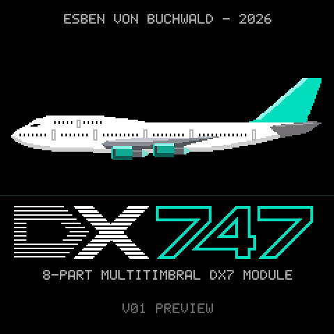{.cover}

::: {.cover-text}
**Eight FM engines. Eight parts. Any of sixteen MIDI channels.**
One compact box that plays your DX7 voices, eight parts at a time.

Try it in the browser and install it from
<https://esbenvb.github.io/fm1-dx747/>

Source, releases and documents: <https://github.com/esbenvb/fm1-dx747>
:::

::: {.contents}
## Contents

1. [What DX747 is](#what-dx747-is)
2. [Installing, and going back](#installing-and-going-back)
3. [The panel](#the-panel)
4. [The screens](#the-screens)
5. [Building a sound](#building-a-sound)
6. [MIDI](#midi)
7. [The web page: configurator, simulator, keyboard, updater](#the-web-page-configurator-simulator-keyboard-updater)
8. [Limits, and what is not in this version](#limits-and-what-is-not-in-this-version)
9. [Troubleshooting](#troubleshooting)
10. [Credits and licence](#credits-and-licence)
:::

# 1 What DX747 is

DX747 is custom firmware for the M-VAVE FM-1. It turns the FM-1 into a **multitimbral, layerable, splittable six-operator FM sound module**: the electric pianos, bells, basses and pads of the DX7 sound world, played and controlled from your keyboard, sequencer, DAW or phone. It replaces the stock sequencer, sampler and drum machine with one job done properly: a DX7 module built for MIDI.

It is not a sequencer, a drum machine or a sampler. It has no projects and no samples. If you need those, use the original firmware or another one: the FM-1 can be switched between firmwares (section 2).

DX747 is a fork of M-VAVE's open firmware (FM1 Open) and has its own identity: release label **V01**, update identity **FM-1_8747747**. It is an independent hobby project by Esben von Buchwald, licensed GPL-3.0 with the FM1 SDK linking exception. It is a tribute to the Yamaha DX7 and has no connection to Yamaha, Boeing or M-VAVE (section 10). The boot screen says `V01 PREVIEW`: V01 is the firmware's release label, and this manual describes release v0.1, a beta.

## The idea in four lines

- A **part** is one MIDI channel with one sound. There are up to **eight** parts, each on its own channel (1 to 16).
- A part's sound is **one to eight layers**. A layer is one DX7 voice on one engine, with its own note window, velocity window, octave shift, level, pan, effect sends and voice limit.
- **Engines are the only limit.** There are eight engines. Eight single-layer parts, or one part of eight layers, or anything in between. The header of every screen shows the **scene** (number and name, or `--` and `NO SCENE`) at the left, and at the right `ENGINES n/8` (layers in use out of the engines that started; if fewer than eight started, for example `3/6` in amber, something went wrong at start-up) and `VOICES n/16` with a load meter that turns amber near the limit.
- Sixteen voices are shared between all engines. A note on a part with n layers uses n voices. When they run out, the oldest note is taken.

A fresh unit starts with eight single-layer parts on channels 1 to 8, so a sequencer can use all eight at once. **To layer, free an engine first**: on the Parts screen select a part and press **LFO** to remove it, then select another part and press **ENV** to give it a layer.

# 2 Installing, and going back

**Read this before you flash.** A firmware that does not start can leave a unit that the web updater cannot repair. The full guide, with the recovery tools, is <https://github.com/esbenvb/fm1-dx747/blob/dx747/docs/FLASHING-AND-RECOVERY.md>. In short:

1. **Have a way back first.** A hardware programmer that can read and rewrite the unit's flash (the community tools are described in the guide), and a backup of the unit's flash made with it.
2. **Back up your own data.** DX747 has no sampler and cannot read the stock samples back. The first time you save a scene, it asks to erase the stock sample bank, because scenes live in that flash. Save samples, projects and voices with M-VAVE's workbench **before** you install, while the original firmware is on the unit.
3. **Install from the web page**, with Chrome or Edge on a computer, the unit connected by USB, the computer set not to sleep and **no other MIDI device or program using MIDI**: open <https://esbenvb.github.io/fm1-dx747/> and go to the **Update** tab (the same package is on the card at The Firmware Hub, thefirmwarehub.com).
    - Tick **I have saved what I want to keep**. The install button stays disabled until you do.
    - Press **Connect for the update** and answer the browser's MIDI and SysEx permission prompt at once.
    - **From a unit that runs the original V15** (or another firmware) the page says "The unit runs another firmware". Tick **Force the update**, press **Connect for the update** again, and accept the warning that a forced update can leave a unit that does not start. That warning is meant seriously.
    - Press **Install DX747**. **While it writes, keep USB and power connected, keep the computer awake and the tab open, and touch nothing.** A power cut or an unplugged cable in the middle can leave a unit that needs the programmer. If it is interrupted, open the page again and connect: a unit in update mode offers to continue. The page itself says that a successful transfer does not guarantee that your data is kept.
    - When it finishes the unit restarts into DX747 (the take-off, then the Parts screen). Press **Connect FM-1** at the top of the page to configure it.
    - The older M-VAVE-style page (`FM1-DX747.html` from the build) has its own labels, and ends with a message about "sample initialization" and an "Invalid file or parameters" error: that is expected there (DX747 has no sample bank) and the firmware is installed.
4. **Going back.** The Update tab carries the original V15 firmware: under **Back to the original**, tick the backup box, press **Connect for the restore**, then **Restore original V15** and confirm. **This replaces all four voice banks with the 128 factory voices and removes DX747 and its saved scenes**, so keep your `.syx` files and write down what you want to keep.

**A newer FM-1 may have a different flash chip** (UC25HQ80 instead of the Puya). The Firmware Hub reports that firmware which only knows the old chip cannot save or update on those units. DX747 has no flash-ID check of its own, but its flash code and its update loader are M-VAVE's binaries, and DX747 has not been tried on such a unit. If scenes will not save, or an update is refused, that is the likely reason.

DX747 brings M-VAVE's own update loader, so other firmwares can be installed over it with their own installers. The author has installed it from V15 and from another firmware, and has installed another firmware over it; that has not been tried with every firmware.

**Switching on.** At power-on the screen plays a five-second take-off of the 747 over the DX747 logo, then shows the Parts screen. Any button, key or knob ends it.

**Safe boot.** Hold **ENV** and **LFO** while switching on. DX747 then starts nothing of its own: no engines, no scenes, no flash, no MIDI. The screen says SAFE BOOT. The firmware updater still works, so a unit that misbehaves can still be updated or sent back to V15. Switch off, let go and switch on again for a normal start. **Safe boot has been tested in the simulator and not yet on a unit, and it cannot help if the unit fails before the chord is read: it is not a replacement for a hardware programmer.** Also: do not hold **OCT−** and **OCT+** together at power-on; that starts the chip's ROM updater, which has never been tried.

# 3 The panel

The buttons keep their stock FM-1 labels; this table is the map for DX747.

| Button | What it does |
|----|------------|
| **HOME** | Parts: one row per part. Press again: the selected part in detail. |
| **SEQ** | Part: the layers of the selected part. |
| **EDIT** | The framed layer: Sound, Range, Velocity, Sends. Press again for the next page. On Mix: the white keys mute and solo. |
| **REC** | MIDI in: the last messages, with the port and channel they came on. |
| **SEL** | Mix: faders, meters, pan, mute and solo for all eight parts. |
| **FX** | Effects (shared reverb and delay). Press again: the Master filter. |
| **PLAY** | Scenes. |
| **GLO** | System settings. |
| **SAVE** | Save a scene. |
| **ARP** | LEARN a note window by playing it. |
| **OCT−**, **OCT+** | Step through pages, rows, banks or parts, depending on the screen. On Parts, Part and MIDI in: shift the built-in keyboard by up to two octaves. |
| **ENV**, **LFO** | Add and remove a layer or part. On Mix: mute and solo. On Scenes: previous and next scene. |
| hold **PLAY** + **OCT−**/**OCT+** | Recall the previous or next stored scene, from any screen (the unit then shows the Scenes screen). |
| hold **HOME** + **PLAY** | Stop every note. |

**Encoders.** **SELECT** picks the part (on Scenes it moves the scene cursor, on System the row). **ALGO** picks the layer inside the part (the "framed" layer) on the Part, detail and layer screens. **PRESETS** chooses the patch (1 to 128) of the framed layer on the Parts, Part and detail screens and on the four layer pages (not on Mix or FX). **K1** to **K4** change the values named in the row of four tiles above the bottom line (or, where there is no tile row, in the bottom line itself, with the control name in green).

**Overlay.** Every knob turn and every message ("LAYER ADDED", "NO FREE ENGINE") shows a box for a moment: what it is in small letters and the new value large, with a bar where the value has a range. Turning PRESETS shows the list of seven patches around the current one.

**Colours.** The accent, used for titles, tabs and frames, is the green of the DX7's buttons. Control names in the tips at the bottom of the screens are green, and the function is white. Parts have fixed colours: red, orange, yellow, green, teal, blue, violet and pink for parts 1 to 8.

**The built-in keys** play the **selected part** on every screen, at a fixed velocity of 100, through the same router as MIDI: layers, splits and shifts included. Exceptions: on Scenes the 16 white keys recall scenes, and on Mix after **EDIT** they mute and solo parts.

**Note names** use the convention where MIDI note 60 is C4.

# 4 The screens

## Parts

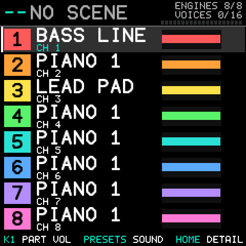{.shot}

Eight rows, always in the same layout: the part number in a coloured chip, the **name** (the name given in the web page, or the voice of the part's main layer), the MIDI channel as `CH n` under it, and a small bar of the layers over the keyboard (splits side by side, layers stacked). `+n` counts the other layers. An amber dot says the part is sounding. The selected part is framed.

**SELECT** picks a part, **ENV** adds a layer to it (or makes a part in an empty slot), **LFO** removes the framed layer (the last layer takes the part with it). **K1** sets the part's volume. **PRESETS** changes the patch of the framed layer.

## Part in detail (HOME twice)

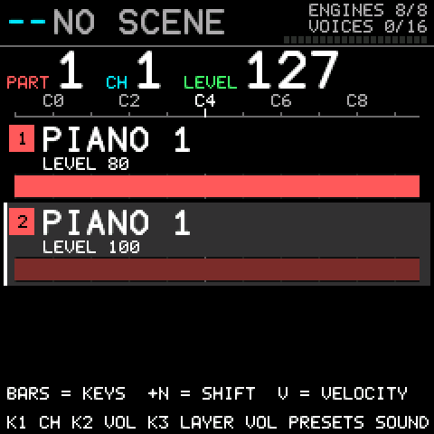{.shot}

One line per layer over a keyboard ruler: the sound, its keys as a bar, an octave shift as a small amber tag, its level, its pan if off centre, and its velocity window if narrowed. The big numbers are the part, its **channel** (**K3**) and its **level** (**K2**). **K1** sets the framed layer's own level, **ALGO** frames a layer, **ARP** learns its keys, **OCT−/OCT+** step to the previous and next part.

## Part (SEQ)

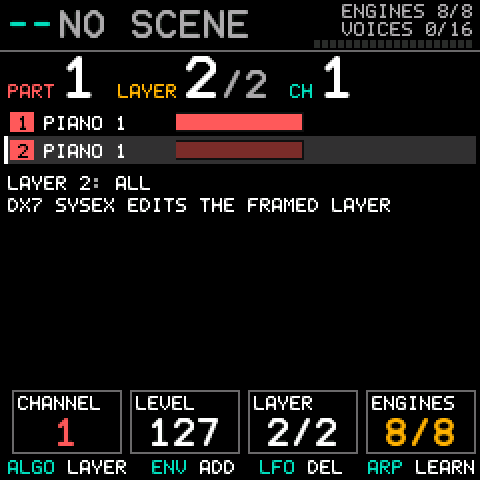{.shot}

The layers of the selected part with their windows, shifts and velocity windows. **ALGO** frames a layer; the framed layer is the one that takes DX7 SysEx. **K1** moves the part to the next free MIDI channel, **K2** sets the part level.

## The layer pages (EDIT)

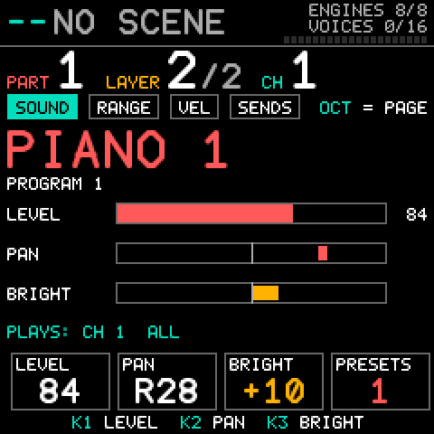{.shot}

Four pages for the framed layer; **EDIT** or **OCT−/OCT+** step between them. Every page has the same header: the part, the layer and the channel as large numbers with small coloured captions.

| Page | K1 | K2 | K3 | K4 |
|---|---|---|---|---|
| **Sound** | layer level | pan | BRIGHT | |
| **Range** | lowest note | highest note | octave shift | fold |
| **Velocity** | lowest velocity | highest velocity | | |
| **Sends** | reverb send | delay send | max voices | |

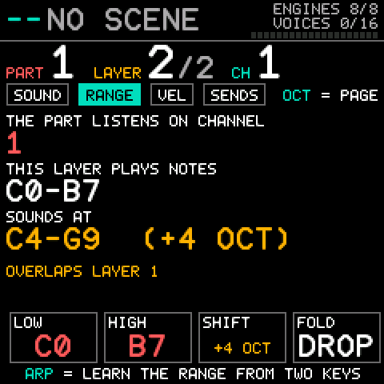{.shot}

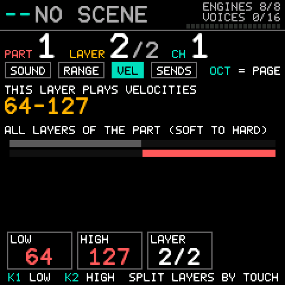{.shot}

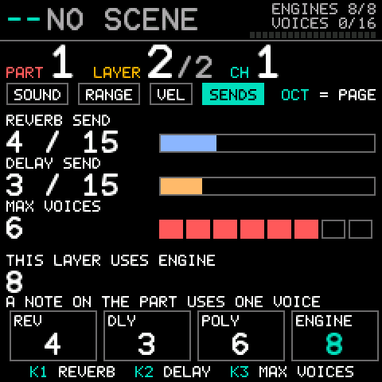{.shot}

**Fold** says what happens to a note the octave shift pushes outside the MIDI range: **drop** it, **clip** it to the nearest end, or **wrap** it back by whole octaves.

## Mix (SEL)

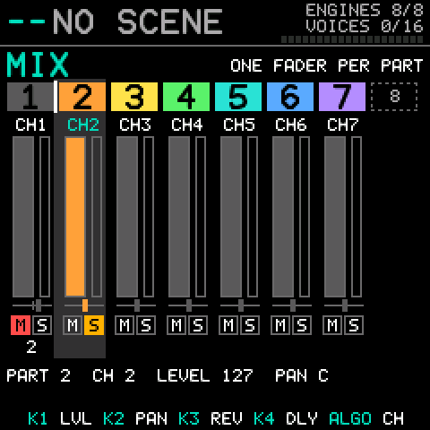{.shot}

One column per part with its channel under the number. Every knob works on the **whole part**: **K1** level (the fader, MIDI CC7), **K2** pan, **K3** reverb send, **K4** delay send; layers that were set apart stay apart. **ALGO** moves the part to the next free channel. **ENV** mutes the selected part, **LFO** solos it. A muted part has a filled red M, a soloed one an amber S, and parts silenced by someone else's solo are dimmed. Solo is not saved in scenes.

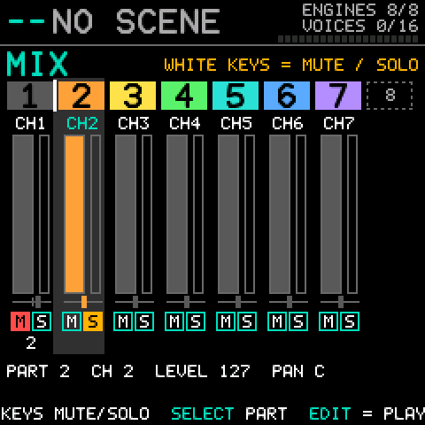{.shot}

**EDIT** turns the white keys into mute and solo keys: key 1 is part 1's mute, key 2 its solo, key 3 part 2's mute, and so on, and touching a part's key also selects the part. The key lamps show what is possible: dark for a part that is not there, dim for a key you could press, bright for a part that is muted or soloed. The black keys do nothing and go dark, and the built-in keys do not play. **Press EDIT again** (or leave the screen) to get the keys back for playing; the hint at the bottom reads `EDIT = PLAY`.

## FX and the Master filter

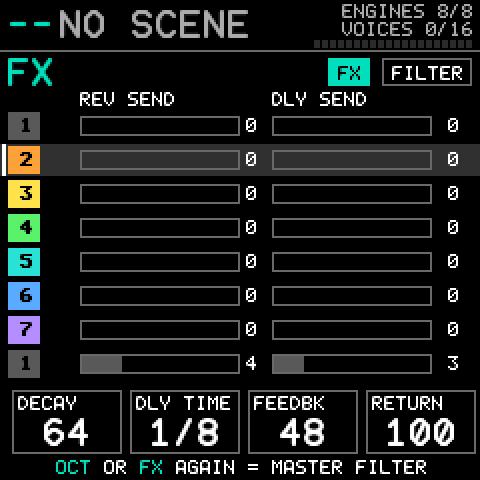{.shot}

**FX** shows each layer's reverb and delay send as bars (**SELECT** picks the part) and, in the four tiles, the shared effect: decay, delay time, feedback and return (**K1** to **K4**). A layer's own amounts are set on the Sends page. Press **FX** again for the **master filter**: type (off, low pass, high pass, band pass), cutoff and resonance, drawn as a curve.

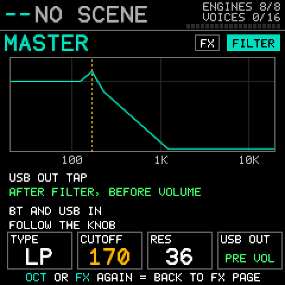{.shot}

The filter sits on the mix of the eight engines. A phone or computer playing through **USB audio in** or **Bluetooth audio in** is added after it and follows the volume knob, so the filter does not touch it. The USB audio that the computer records is taken after the filter and before the volume knob.

## Scenes (PLAY)

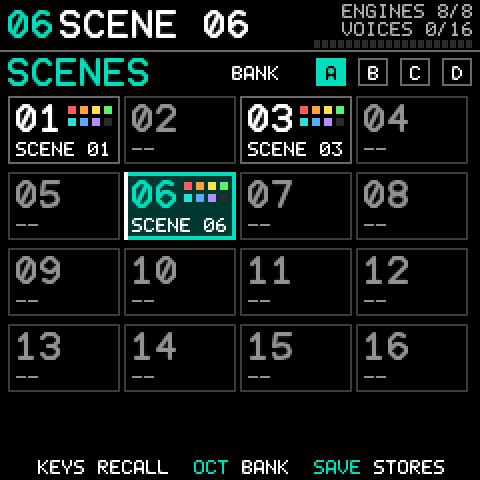{.shot}

64 scenes in four banks (A to D) of 16. White key n recalls scene n of the bank on screen. **OCT−/OCT+** change the bank, **ENV/LFO** step to the previous and next stored scene. **SAVE** stores the current setup. The slot is the **scene cursor** on the Scenes screen, which starts on slot 1 each time you switch on: **SELECT** moves it (**OCT−/OCT+** change the bank), but a **white key on a stored scene recalls it**, which replaces the current setup before you save. From any screen, **SAVE** jumps to Scenes and opens the name editor with the slot's existing name; edit the name with **K1** (cursor) and **K2** (letter), then press **SAVE** again to store. **That overwrites a scene that is already in the slot, without asking**; **HOME** cancels.

A scene stores all eight parts (channel, level, layers, each with voice, windows, shift, fold, voice limit, level, pan, sends, BRIGHT and mute), the selected part, the effects, the master filter and a 12-character name. It stores a **copy** of the voices, so editing a patch later never changes an old scene. The last scene used comes back at power-on. A power cut while saving can never damage another scene.

The **first save** asks "FIRST SAVE: FLASH SETUP" and shows `SAVE = ERASE AND CONTINUE`: pressing **SAVE** there **erases the stock sample bank** (and an unfinished stock save left behind by a power cut), and cannot be undone. Press **HOME** to cancel; until you agree DX747 writes nothing to that flash, not even the System settings, which therefore do not survive a power cycle yet.

## System (GLO)

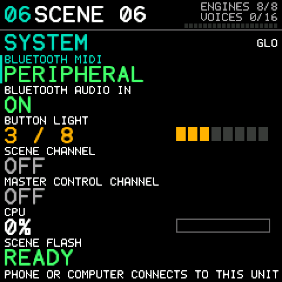{.shot}

**SELECT** or **OCT−/OCT+** pick a row, **K1** (or **PRESETS**) changes it. The rows: Bluetooth MIDI (PERIPHERAL: a phone or computer connects to the FM-1; read-only), Bluetooth audio in (on or off), button light (0 to 8), the **scene channel** and the **master control channel** (each Off or 1 to 16, section 6), CPU load (read-only) and **scene flash**: `NEEDS SETUP` on a unit that has not saved a scene yet (the first save will ask to erase the sample bank), `READY` afterwards. These are device settings and are not part of a scene.

## MIDI in (REC)

A live list of the latest notes, controllers and program changes with the port (DIN, USB, Bluetooth or the keys) and the channel they came on. Every channel that is sending lights up, so finding the right channel is a glance.

# 5 Building a sound

## Patches

The 128 patches are four banks of 32: A is 1 to 32, B 33 to 64, C 65 to 96, D 97 to 128. Turn **PRESETS** on the Parts, Part or detail screen or on a layer page. The list shows three patches before and three after the current one.

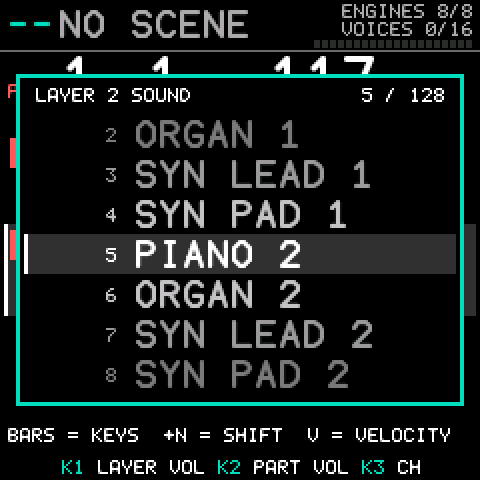{.shot}

## Layering

On a fresh unit all eight engines are in use, so first press **LFO** on a part you do not need. Then select the part you want to layer and press **ENV** on the Parts screen: it gets a second layer on the lowest free engine, with the full keyboard, full velocity range and level 127, which is a **stack**; narrow the note window to make a split. The new layer is the framed one, so **PRESETS** gives it a patch at once. To work on another layer use **ALGO** on the Part, detail or a layer screen, and give each layer its own patch, level, pan and sends so that you balance the stack like a mix. Up to eight layers fit in one part if the engines are free.

## Splits: set a note window by playing it

On the Part or Range screen press **ARP** (LEARN), then play the **lowest and the highest note**, in either order, on the built-in keys or any MIDI keyboard. The window of the framed layer becomes those two notes. Two layers with windows that do not overlap make a keysplit; layers with the same window make a stack.

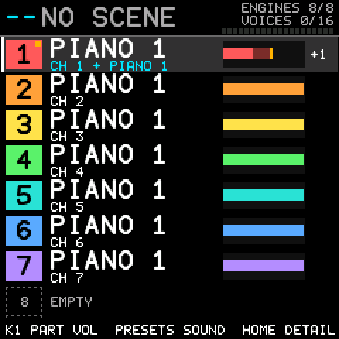{.shot}

## Velocity switching

On the Velocity page give each layer a window of velocities. A soft touch can play one sound and a hard hit another. A layer plays a note only when its velocity is inside the window (1 to 127, the default, accepts everything). The built-in keys send a fixed velocity of 100; use a velocity-sensitive MIDI keyboard for this.

## Octave shift

Each layer moves up to **four octaves** up or down (Range page, **K3**). A split with an octave change is one window and one shift: bass an octave down on the left, lead an octave up on the right. A shift shows as a small amber tag on the detail screen.

## BRIGHT

BRIGHT is an FM "filter" in one control. It moves the output level of the **modulator** operators of the voice, never the carriers, so the sound gets brighter or duller without getting louder or quieter. It is on the Sound page (**K3**), and MIDI CC74 or CC71 on a part's channel sets it for all the part's layers. The voice's own levels are remembered: changing the patch starts again from the new voice.

## Voice limit

Each layer has its own limit, 1 to 8 voices (default 4), on the Sends page. A note uses one voice per layer that plays it.

# 6 MIDI

**Connecting.** The FM-1 takes MIDI on its TRS DIN socket (the socket's wiring is in M-VAVE's own manual; use a matching cable or adapter), on USB (it shows up on the computer as a USB MIDI device, and as a USB audio device for the audio out), and over Bluetooth LE: the phone or computer connects to the FM-1, which is a Bluetooth peripheral (System screen: Bluetooth MIDI, PERIPHERAL). All three feed one router, together with the built-in keyboard.

**DX747 only receives.** It has no MIDI out or Thru, MIDI clock and transport (start/stop) messages are not used, and SysEx other than the DX7 messages below and the workbench's own is ignored. System Reset acts as a panic (all sound off).

A note on channel c is played by every layer of the part on c whose note window and velocity window contain it, moved by that layer's shift. A note off always reaches the engines that got the note on, even if settings changed meanwhile.

| Message | Effect |
|----|------------|
| Note on/off | Plays the voice at the velocity it arrived with. |
| Program change 0 to 127 | Picks the part's sound. On a one-layer part it loads that patch. On a **layered** part it replaces all layers with that one patch over the whole keyboard (the first layer stays at its own level). |
| Bank select (CC0) | Remembered per channel. Only bank 0, the DX7 patches, exists; a program change after another bank is ignored. |
| CC7 | The **part level**. Every layer plays at its own level times the part level / 127. |
| CC10, CC11 | Pan and expression. |
| CC74 or CC71 | The **BRIGHT** of every layer of the part (64 is centre, 127 is +50, 0 is −50). |
| CC91 | Reverb send. |
| CC1, channel pressure | Vibrato. |
| CC64 | Sustain pedal. |
| Pitch bend | Plus or minus two semitones. |
| CC120, CC121, CC123 | All sound off, reset controllers, all notes off. |

**Scene channel.** Set one on the System screen (Off by default; remembered). A program change on that channel recalls scene n + 1 (0 to 63); an empty slot does nothing. Use a channel no part uses, because a program change there never reaches a part. MIDI Song Select works the same where the sealed engine hands it on to the firmware; that has been seen in the simulator and not yet on a unit.

**Master control channel.** Set one on the System screen, on a channel **no part uses**: the controllers below are taken for the filter and never reach a part, so a part on that channel would lose its CC74 and CC71 BRIGHT, and the unit does not warn you about this one. On it, **CC74** is the filter cutoff (20 Hz to 20 kHz), **CC71** the resonance, and **CC70** the type (0 to 31 off, 32 to 63 low pass, 64 to 95 high pass, 96 to 127 band pass).

## DX7 SysEx and editors

A DX7 editor can change voice parameters in real time and send single voices (163 bytes). They go to the **framed layer** of the part on the message's MIDI channel (a DX7 message carries a device number *n* from 0 to 15, which is MIDI channel *n* + 1, so set your editor's channel to the part's channel; frame a layer with **ALGO** on the Part screen, layer 1 until you do). A layered part is therefore never overwritten by accident. The 32-voice bank dump (4,104 bytes) cannot reach the unit over MIDI, because the FM-1's MIDI input discards SysEx over 1,024 bytes: load banks with the web page (next section). The unit does not send voice dumps.

The complete reference, including the SysEx formats, is <https://github.com/esbenvb/fm1-dx747/blob/dx747/docs/MIDI.md>.

# 7 The web page: configurator, simulator, keyboard, updater

**<https://esbenvb.github.io/fm1-dx747/>**, or `DX747-Workbench.html` from the repository's build. One page with everything in it. Open it in **Chrome or Edge on a computer**.

At the top choose **Simulator** (the DX747 firmware compiled to run in the page, with the panel's screen, buttons, encoders and keys; its sound comes from an open stand-in for the sealed sound engine, rendered in the browser with more latency than the unit's, so it is a test bench and not a substitute for the unit) or **Connect FM-1 (USB)** (your unit, over Web MIDI with SysEx allowed). Every tab then works on the chosen target, and the page follows the unit: a change made on the panel shows in the page and the other way round.

| Tab | What it is |
|----|------------|
| **Device** | The simulator panel. Click once to switch the sound on. Its scenes and settings are kept in the browser. |
| **Configure** | All eight parts and their layers: channel, level and name per part; per layer the voice, level, pan, BRIGHT, reverb and delay, key range on a keyboard, octave shift, fold, velocity window, polyphony, mute and solo. Add and remove layers and parts. **Play this part** selects the part the keys play. |
| **Sounds** | The 128 voices in four banks by name (click one to give it to the framed layer) and **DX7 ROM import** into a bank. |
| **Scenes** | The 64 scenes: names, which parts they hold, recall, save, rename, delete. |
| **Master and FX** | The master filter, the shared reverb and delay, the scene channel, the master control channel, the button light, Bluetooth audio in. |
| **Keyboard** | An on-screen piano that you can also play from the computer keyboard, with a choice of MIDI channel, output and velocity, a panic button, and a monitor. |
| **Update** | Installs the DX747 firmware that is inside the page, or restores the original V15. Read section 2 first. |

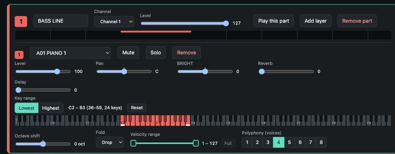{.wide}

In **Configure**, pan, BRIGHT and the octave shift snap to the centre while you drag (double-click goes there). The key range is picked on a keyboard: click or drag to set the **Lowest** or **Highest** key, and **Reset** selects the whole keyboard. The velocity window has a handle at each end. The names you give parts show on the unit's Parts screen (the first ten letters). In synchronised mode the delay uses a fixed tempo: DX747 does not follow MIDI clock.

The voice lists show the **presets read from the unit's own library**, so what the page shows is what the unit holds. **Reload presets** reads them again.

## Importing a DX7 ROM

In **Sounds**, choose a standard 32-voice DX7 bank file (a 4,104-byte `.syx`, such as a ROM cartridge dump), choose the bank (A to D) and press **Import into the unit**. The page checks the file, writes it, and reads it back. The BC voices of the DX7 ROMs (for example "SAX BC") play as they should: DX747 opens the breath controller for them.

# 8 Limits, and what is not in this version

- No sequencer, drum machine or sampler; no projects or samples. DX747 cannot read the projects or samples of another firmware.
- Voice parameters (envelopes, LFO) cannot be edited on the unit: change them over SysEx or in a DX7 editor.
- The 32-voice bank cannot be sent over MIDI (the 1,024-byte SysEx limit); use the web page.
- Audio over Bluetooth is receive-only (phone or computer to the FM-1); the FM-1 cannot send audio to a Bluetooth speaker or connect out to a Bluetooth keyboard.
- **USB audio out** is the finished mix of the engines, taken after the master filter and before the master volume knob.
- Several details have only been checked in the simulator and not yet on a unit (MIDI Song Select, safe boot, the lamp levels and others); the list is <https://github.com/esbenvb/fm1-dx747/blob/dx747/docs/ON-DEVICE-CHECKLIST.md>.
- A user sound library with its own banks is planned, not built. Scenes already carry layered sounds, so a sound can be kept by saving a scene.

# 9 Troubleshooting

| Symptom | What to do |
|-----|-----------|
| No sound from the built-in keys | The selected part may be an empty slot: select a part (**SELECT**) or press **ENV** to make one. |
| A part is silent | It may be muted, or another part is soloed (Mix). A layer's note or velocity window may not contain what you play (Range and Velocity pages). |
| "NO FREE ENGINE" | All eight engines are in use. Remove a layer or part first (**LFO**). |
| A sequencer's program change switches scenes | That channel is the scene channel (System). Choose a channel no part uses. |
| Voices from a ROM are silent | Import them with the web page, and see section 7. |
| The web page cannot connect | Use Chrome or Edge, allow MIDI with SysEx, close other MIDI programs, use a good USB cable. |
| The unit misbehaves | Switch off, hold **ENV** and **LFO** and switch on (safe boot), then update or restore from the web page. Safe boot has not been tried on a unit; have your programmer ready (section 2). |

# 10 Credits and licence

DX747 is an independent hobby project by Esben von Buchwald. It is built on M-VAVE's open FM-1 firmware and SDK (FM1 Open), whose sealed sound engine implements the DX7 voices; the update loader is M-VAVE's. Code written for DX747 is licensed GPL-3.0-only with the SDK's linking exception (`LICENSE.md` and `THIRD_PARTY.md` in the repository).

**DX747 is a tribute to the Yamaha DX7.** It is **not in any way associated with, endorsed by, sponsored by or supported by Yamaha Corporation, The Boeing Company or M-VAVE.** "DX7" is a Yamaha product name and "747" is a Boeing aircraft designation; any trademarks of Yamaha or Boeing belong to their owners and no rights to them are claimed. The names say what the firmware is a tribute to and what its logo looks like.

Flashing unofficial firmware is at your own risk. Read the recovery guide first.

Source and issues: <https://github.com/esbenvb/fm1-dx747> · Listing: The Firmware Hub, <https://thefirmwarehub.com>
